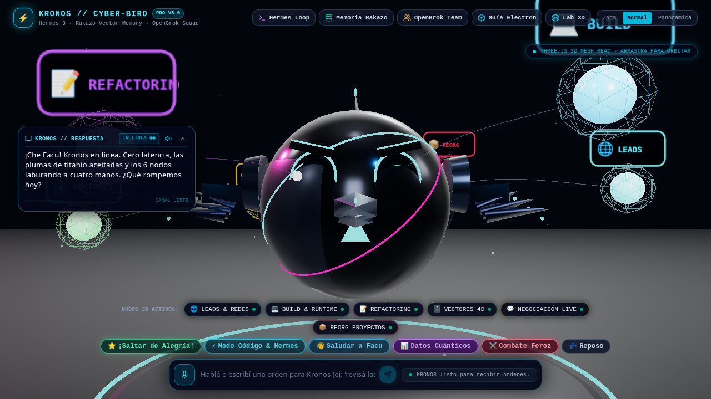

# ⚡ Dee-Bot-Agents (`v4.0 Pegasus Supreme`)

> **Creado por [Facu Cercuetti (@NickDev24)](https://github.com/NickDev24) · Blog Oficial: [facucercuetti.online/blog](https://facucercuetti.online/blog)**  
> **Sistema Operativo de Agentes Autónomos Físico-Espaciales de Ultra-Bajo Consumo (100% en Español y 0% Simulado)**  
> **Control Físico Total de PC en C/X11 (`libX11` + `libXtst`) · Gateway Atómico (`:8730`) & Workbench de Procesos (`:8731`) · Driver Nativo CDP (`@ref`) · Motor RAG SQLite FTS5 0-RAM (`<3ms`) · Motor Relay Transaccional (`JSONL`) · Git Worktree Forge · Oídos ALSA + Biometría Vocal 12-D · Ojos Multi-Cámara + Guardia de Intrusos · Voz Argentina Lip-Sync 30 FPS · Escritorio Nativo Electron con 6 Agentes 3D Iguales de Distinto Color**

[-00f0ff.svg)](https://github.com/NickDev24)
[](https://facucercuetti.online/blog)
[](LICENSE)
[](desktop/)
[](docker-compose.yml)



---

## 🎬 Videos Tutoriales, Capturas y Artículos Explicativos

| Recurso | Descripción | Enlace Directo |
| :--- | :--- | :--- |
| **🎥 Video Tutorial 01** | Cómo descargar, instalar, configurar y desplegar `Dee-Bot-Agents` (Nativo, Electron y Docker) con voz argentina narrada | [`docs/tutorials/videos/video_01_instalacion_y_deploy_completo.mp4`](docs/tutorials/videos/video_01_instalacion_y_deploy_completo.mp4) |
| **🎥 Video Tutorial 02** | Demo en vivo de ejecuciones en terminal, pruebas de integridad, sensores físicos y cabina espacial 3D | [`docs/tutorials/videos/video_02_demo_terminal_y_hud_3d.mp4`](docs/tutorials/videos/video_02_demo_terminal_y_hud_3d.mp4) |
| **📰 Pack de Artículos para Blog** | 4 artículos técnicos y tutoriales listos para publicar en **[facucercuetti.online/blog](https://facucercuetti.online/blog)** | [`docs/ARTICULOS_BLOG_FACUCERCUETTI_ONLINE.md`](docs/ARTICULOS_BLOG_FACUCERCUETTI_ONLINE.md) |
| **📐 Plan Maestro Forense** | Documento de arquitectura, benchmarks y superación de `Muse` + `Grok Bot` + `Hermes` | [`docs/ARCHITECTURE_MASTER_PLAN.md`](docs/ARCHITECTURE_MASTER_PLAN.md) |

---

## 🌟 ¿Por qué `Dee-Bot-Agents v4.0 Pegasus Supreme` supera a Muse, Grok Bot y Hermes?

Diseñado por **Facu Cercuetti (`@NickDev24`)**, `Dee-Bot-Agents` convierte un clúster doméstico de bajo consumo (**Intel Pentium B950 / Celeron N4020** sin GPU dedicada) en un **sistema operativo autónomo nivel Pegasus**, capaz de hacer **absolutamente todo lo que un humano hace dentro de una PC y mucho más**, sin nada simulado:

1. **🖱️ Control Físico Nativo de PC en C/X11 (`core/computer_use/human_pc_controller.py`)**:
   - Enlace directo en C (`ctypes`) contra `libX11.so.6` y `libXtst.so.6` (`XInitThreads` + `XQueryPointer` + `XTestFakeMotionEvent` + `XTestFakeButtonEvent` + `XTestFakeKeyEvent`) con latencia **`< 0.1 ms`**.
   - Mueve el cursor real, hace clic izquierdo/medio/derecho, doble clic, arrastra (`drag & drop`), escribe texto y combinaciones de teclado (`Ctrl+C`, `Alt+Tab`, `Return`, `Escape`), inspecciona todas las ventanas abiertas (`xwininfo`), captura el escritorio completo en vivo (`ffmpeg x11grab`) y controla el volumen maestro (`pactl`).

2. **📦 Gateway Atómico de Archivos (`:8730`) & Workbench de Grupos de Procesos (`:8731`) (`node_agent/` & `bin/`)**:
   - Supera a `muse-local-gateway` con transferencia atómica de archivos (`.dee_tmp_* -> os.replace`) verificada con **SHA-256**, listado de directorios (`GET /ls`), parches quirúrgicos (`POST /patch/<rel>`), ACL de subred LAN y protección contra Path Traversal.
   - El **Workbench (`:8731`)** ejecuta comandos en grupos de procesos aislados (`start_new_session=True`), soporta espera síncrona + sondeo asíncrono (`GET /exec/<id>`), aniquilación limpia de árboles de procesos (`os.killpg` con `SIGTERM -> SIGKILL`) y puente de hardware **USB/Serial (`/dev/ttyUSB*`, `/dev/ttyACM*`)**.
   - Incluye herramientas CLI listas en `bin/`: `gateway-check.sh`, `gateway-put.sh`, `gateway-get.sh`, `gateway-exec.sh`.

3. **🌐 Driver Nativo CDP (Chrome DevTools Protocol) & Sesiones Web (`core/computer_use/cdp_browser_driver.py`)**:
   - Inspecciona pestañas activas de Chrome/Chromium (`:9222`), lanza instancias con depuración remota, extrae el **Mapa Interactivo DOM con selectores `@ref` (`@n1`, `@n2`...)**, mantiene sesiones con `CookieJar` persistente y captura pantallas web reales.

4. **🧠 Motor RAG Local 0-RAM sobre SQLite FTS5 / BM25 (`core/orchestrator/local_rag.py`)**:
   - Mientras `muse-spark` tenía un `rag_manager.py` simulado con comentarios de ChromaDB/LangChain (que consumirían >1.5 GB de RAM), Dee implementa un motor **SQLite FTS5 con ranking BM25** en la librería estándar de Python: **0 MB de RAM en reposo** y búsquedas en **`< 3 ms`** sobre cientos de fragmentos de código y documentación.

5. **🔄 Motor Relay Transaccional Durable & Forja de Git Worktrees (`core/orchestrator/relay_engine.py` & `worktree_forge.py`)**:
   - Máquina de estados transaccional (`prepared -> sending -> sent -> completed | paused | rejected`) persistida en `data/relay/records.jsonl` con políticas `busyPolicy` (`steer`, `queue`, `reject`) y `RouteEnvelope` anti-bucle (`hop < 4`).
   - Creación y limpieza de **Git Worktrees aislados** en `/tmp/dee-worktrees` para que cada subagente trabaje en su propia rama sin conflictos.

6. **👂👁️🗣️ Sistema Sensorial Físico Completo (`core/sensory/`)**:
   - **Oídos ALSA (`ears.py` + `speaker_id.py`)**: Doble aplauso (`120–850 ms`), VAD adaptativo, Barge-In y **Biometría Acústica Vocal 12-D** de Facu.
   - **Ojos Multi-Cámara (`eyes.py`)**: Filtro PGM de 2 niveles (`9x8 dHash` + `30x30 diff` en `<15 ms`) y detección de Facu vs. Intrusos con captura forense.
   - **Voz Argentina con Lip-Sync a 30 FPS (`voice.py`)**: `edge-tts` (`es-AR-TomasNeural`) + `FreeLLMAPI` + `Piper ONNX` con extracción de visemas reales.

7. **🦅 Aplicación Nativa de Escritorio Electron + Escuadrón de 6 Agentes 3D (`desktop/` & `frontend/`)**:
   - Se ejecuta como **aplicación de escritorio nativa Electron** (`./scripts/iniciar_escritorio_electron.sh`) o en navegador (`:8091`), **100% en español**.
   - **Dee Prime (`#00f0ff`)** y sus **5 Subagentes** (`Hermes X11` `#ec4899`, `Barto Forge` `#10b981`, `Manager Scout` `#f59e0b`, `Sentinel Guard` `#f43f5e`, `Rakazo Archivist` `#a855f7`) comparten el mismo modelo 3D (`CyberBird3D`) con sus colores distintivos, pudiendo alternar el agente principal o desplegar la **Formación 3D de los 6 Agentes en Escena**.
   - **Terminal en Vivo Flotante y Movible (`DraggableLiveTerminal.tsx`)** que se despliega automáticamente en cada tarea.

---

## 🚀 Guía Paso a Paso: Descarga, Instalación, Escritorio Electron y Deploy

### Opción 1: Ejecución Nativa + Escritorio Electron (`< 45 MB RAM` en el Core)

```bash
# 1. Clonar el repositorio oficial de Facu Cercuetti (@NickDev24)
git clone https://github.com/NickDev24/Dee-Bot-Agents.git
cd Dee-Bot-Agents

# 2. Instalar estructura de datos y compilar HUD 3D
./scripts/install.sh

# 3. Iniciar Gateway (:8730), Workbench (:8731) y Dee Core (:8091)
./scripts/start_dee.sh

# 4. Abrir la Aplicación de Escritorio Nativa Electron (estilo Grok Bot / Muse)
./scripts/iniciar_escritorio_electron.sh
```

### Uso de la CLI Táctica Pegasus (`cli/dee_cli.py`) y Herramientas de Gateway (`bin/`)

```bash
# Estado físico de la PC en X11 (resolución, coordenadas del mouse, ventanas abiertas y volumen)
python3 cli/dee_cli.py pc estado
python3 cli/dee_cli.py pc mover --x 680 --y 380
python3 cli/dee_cli.py pc clic --button 1
python3 cli/dee_cli.py pc captura

# Búsqueda instantánea (<3ms, 0 MB RAM) en el motor RAG SQLite FTS5 BM25
python3 cli/dee_cli.py rag "Pegasus Gateway Facu Cercuetti"

# Mapa interactivo DOM (@ref) y cookies mediante el Driver CDP
python3 cli/dee_cli.py cdp "https://facucercuetti.online/blog"

# Despacho transaccional con RouteEnvelope (hop < 4) en el Motor Relay
python3 cli/dee_cli.py relay "uname -a && uptime" --target facu

# Gestión de Git Worktrees aislados para los subagentes
python3 cli/dee_cli.py worktree listar

# Herramientas directas del Gateway (:8730) y Workbench (:8731)
./bin/gateway-check.sh
./bin/gateway-put.sh 127.0.0.1:8730 README.md backup/README.md
./bin/gateway-get.sh 127.0.0.1:8730 backup/README.md /tmp/README_verificado.md
./bin/gateway-exec.sh 127.0.0.1:8731 "uname -n && free -h"
```

### Opción 2: Despliegue con Docker

```bash
docker compose up -d --build
curl http://127.0.0.1:8091/health
```

---

## 🧪 Suite de Pruebas de Integridad Pegasus (`12/12 Tests Reales OK`)

```bash
python3 scripts/smoke_test.py
```

Verifica los **12 subsistemas reales**:
1. `[1/12]` Biometría Acústica Vocal 12-D PCM16
2. `[2/12]` Extractor Lip-Sync 30-FPS + Fonética Rioplatense
3. `[3/12]` Visión PGM de 2 Niveles (`9x8 dHash` + `30x30 diff`)
4. `[4/12]` Supervisor de Seguridad Sentinel (`ALLOW` / `ASK_FACU` / `DENY_ALWAYS`)
5. `[5/12]` Gestor de Clúster & `RouteEnvelope` Anti-Bucle
6. `[6/12]` Ruta Rápida Cero-Tokens (`< 1 ms`, 0 tokens)
7. `[7/12]` Memoria Markdown 0-RAM & 15 Habilidades Cristalizadas
8. `[8/12]` Custodio de Disco Butler
9. `[9/12]` Gateway Atómico de Archivos (`:8730`) & Workbench de Procesos (`:8731`)
10. `[10/12]` Control Físico Nativo PC en C/X11 (`libX11.so.6` + `libXtst.so.6`)
11. `[11/12]` Motor RAG Local 0-RAM sobre SQLite FTS5 BM25 (`< 3 ms`)
12. `[12/12]` Driver CDP (`@ref`), Motor Relay Transaccional (`JSONL`) & Git Worktree Forge

---

## 👨‍💻 Autor y Créditos

- **Autor Principal & Arquitecto**: **Facu Cercuetti**
- **GitHub**: [@NickDev24](https://github.com/NickDev24)
- **Repositorio Oficial**: [https://github.com/NickDev24/Dee-Bot-Agents](https://github.com/NickDev24/Dee-Bot-Agents)
- **Blog Oficial**: [https://facucercuetti.online/blog](https://facucercuetti.online/blog)
- **Licencia**: Distribuido bajo la licencia **[MIT](LICENSE)**.
