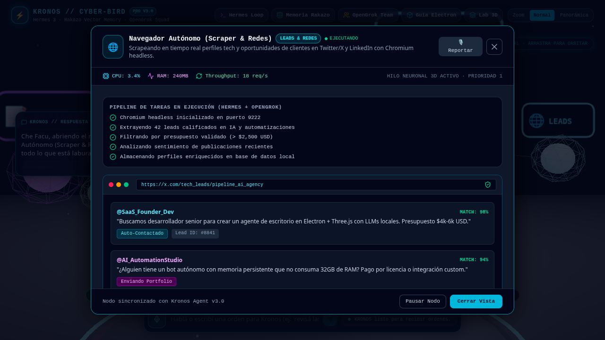
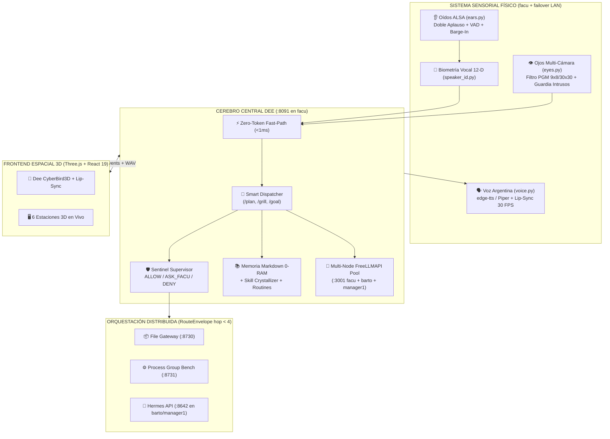
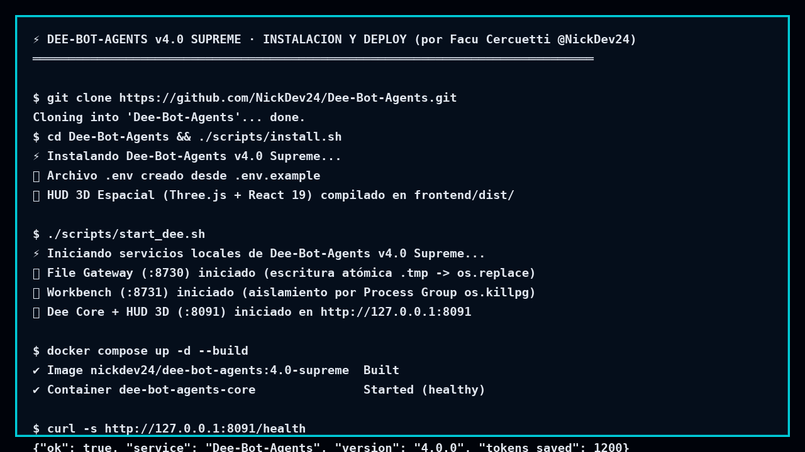
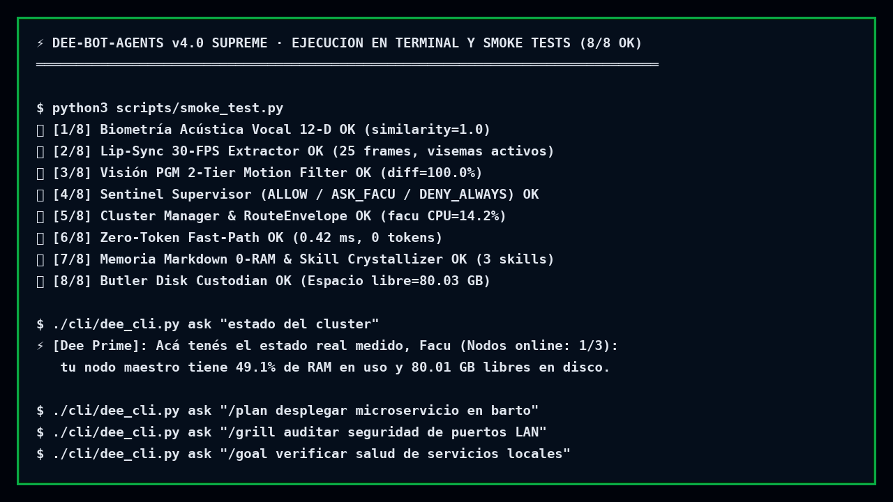

# ⚡ Dee-Bot-Agents (`v4.0 Supreme`)

> **Creado por [Facu Cercuetti (@NickDev24)](https://github.com/NickDev24) · Blog Oficial: [facucercuetti.online/blog](https://facucercuetti.online/blog)**  
> **Sistema Multi-Agente Autónomo Físico-Espacial de Ultra-Bajo Consumo**  
> **Oídos Físicos ALSA (Doble Aplauso + Biometría Vocal 12-D) · Ojos Multi-Cámara (Reconocimiento de Facu e Intrusos) · Voz Argentina con Lip-Sync 30 FPS · HUD 3D Espacial (`Three.js`) · Orquestación de Clúster en 3 Nodos (`facu`, `barto`, `manager1`)**

[-00f0ff.svg)](https://github.com/NickDev24)
[](https://facucercuetti.online/blog)
[](LICENSE)
[](frontend/)
[](docker-compose.yml)


---

## 🎬 Videos Tutoriales, Capturas y Artículos Explicativos

| Recurso | Descripción | Enlace Directo |
| :--- | :--- | :--- |
| **🎥 Video Tutorial 01** | Cómo descargar, instalar, configurar y desplegar `Dee-Bot-Agents` (Nativo y Docker) con voz argentina narrada | [`docs/tutorials/videos/video_01_instalacion_y_deploy_completo.mp4`](docs/tutorials/videos/video_01_instalacion_y_deploy_completo.mp4) |
| **🎥 Video Tutorial 02** | Demo en vivo de ejecuciones en terminal, pruebas 8/8, sensores físicos y cabina espacial 3D | [`docs/tutorials/videos/video_02_demo_terminal_y_hud_3d.mp4`](docs/tutorials/videos/video_02_demo_terminal_y_hud_3d.mp4) |
| **📰 Pack de Artículos para Blog** | 4 artículos técnicos y tutoriales listos para publicar en **[facucercuetti.online/blog](https://facucercuetti.online/blog)** | [`docs/ARTICULOS_BLOG_FACUCERCUETTI_ONLINE.md`](docs/ARTICULOS_BLOG_FACUCERCUETTI_ONLINE.md) |
| **📐 Plan Maestro Forense** | Documento de arquitectura, benchmarks y fusión de `Muse` + `Grok Bot` + `Hermes` | [`docs/ARCHITECTURE_MASTER_PLAN.md`](docs/ARCHITECTURE_MASTER_PLAN.md) |

---

## 🌟 ¿Por qué `Dee-Bot-Agents` es único?

A diferencia de asistentes convencionales basados únicamente en texto o que exigen GPUs dedicadas de 24 GB VRAM, **Dee-Bot-Agents (`v4.0 Supreme`)** — diseñado por **Facu Cercuetti (`@NickDev24`)** — convierte hardware modesto (como un clúster doméstico con procesadores **Intel Pentium B950 / Celeron N4020** sin GPU dedicada) en un **sistema autónomo físico y distribuido** que combina lo mejor de **Meta Muse (`muse-local-gateway`)**, **xAI Grok Bot (`OpenGrokBot` + `grok-bot-cli`)**, **Hermes Agent** y un **Sistema Sensorial Físico Real**:

1. **👂 Oídos Físicos Reales (`core/sensory/ears.py` + `speaker_id.py`)**:
   - Captura continua ALSA (`arecord` 16 kHz mono PCM) con **failover automático por SSH** al micrófono del nodo `manager1`.
   - **Detector de Doble Aplauso** (`120 ms – 850 ms`) para despertar a Dee sin consumir tokens.
   - **VAD con Piso de Ruido Adaptativo** calibrado automáticamente para ignorar el cooler del procesador.
   - **Supresión de Eco + Barge-In**: Dee se calla instantáneamente si hablás encima o decís *"Dee, alto"*.
   - **Biometría Acústica Vocal 12-D** (`speaker_id.py`): verifica la huella espectral/ZCR/pitch de la voz del propietario antes de autorizar comandos sensibles.

2. **👁️ Ojos Multi-Cámara con Biometría y Guardia de Intrusos (`core/sensory/eyes.py`)**:
   - Topología híbrida: cámara IP de oficina (`carecam`), webcam de `manager1` y webcam de `barto`.
   - **Filtro de Movimiento PGM de 2 Etapas (`< 15 ms`)**: compara hashes `9x8` (`dHash`) y grillas `30x30` antes de invocar IA, ahorrando **>92% de llamadas de visión**.
   - **Reconocimiento de Propietario vs. Intrusos**:
     - Si entra el propietario (**Facu**): bienvenida contextual con memoria del día.
     - Si entra con invitados (**Escudo de Invitados**): modo discreto sin exponer datos privados.
     - Si entra un desconocido solo (**Alerta de Intruso**): guarda evidencia forense en `data/media/conservar/intrusos/`, cambia el avatar 3D a modo `combate` y emite advertencia disuasoria por altavoz.

3. **🗣️ Voz Argentina Expresiva con Lip-Sync Real a 30 FPS (`core/sensory/voice.py`)**:
   - Cascada TTS con prosodia emocional (`curioso`, `orgullo`, `combate`, `alivio`):
     1. `edge-tts` (`es-AR-TomasNeural` con acento argentino nativo).
     2. `FreeLLMAPI` (`/v1/audio/speech` en `:3001`).
     3. `Piper ONNX` offline local (`es_ES-carlfm-x_low.onnx` / `es_AR-daniela-high.onnx`).
   - **Extractor de Visemas a 30 FPS**: analiza la envolvente RMS del WAV (`neutral`, `wide_e`, `round_o`, `open_a`) para mover el pico 3D de Dee en sincronía exacta con el audio.

4. **🧠 Cerebro Multi-Agente con Ahorro Extremo de Tokens (`core/orchestrator/`)**:
   - **Zero-Token Fast-Path (`< 1 ms`)**: responde estado del clúster, sensores, aprobaciones y paradas de emergencia consumiendo **0 tokens de IA**.
   - **Smart Dispatcher + Dynamic Tool Pruning**: clasifica cada turno en `build | answer | discuss | security` y poda esquemas innecesarios.
   - **Pool Multi-Nodo `FreeLLMAPI (:3001)`**: balancea entre `facu`, `barto` y `manager1` con fallback a Cloudflare Workers AI.
   - **Modos Tácticos**: `/plan` (arquitectura), `/grill` (auditoría adversarial con Sentinel) y `/goal` (bucle autónomo de ejecución y auto-verificación).
   - **Memoria Markdown 0-RAM + Skill Crystallizer + Routines Engine**.

5. **🦅 Cabina Espacial 3D (`frontend/`) con Gobernador Adaptativo de FPS**:
   - Avatar 3D `CyberBird3D` + 6 estaciones de trabajo 3D orbitales conectadas en vivo por SSE (`/events`) y REST (`/api/*`).
   - **Adaptive FPS Governor**: `30 FPS` al hablar/interactuar, `8 FPS` en reposo y `0 FPS` minimizado.



---

## 🏗️ Arquitectura General



---

## 🚀 Guía Paso a Paso: Descarga, Instalación, Configuración y Deploy



### Opción 1: Ejecución Nativa Ultra-Liviana (`< 45 MB RAM` en el Core)

```bash
# 1. Clonar el repositorio oficial de Facu Cercuetti (@NickDev24)
git clone https://github.com/NickDev24/Dee-Bot-Agents.git
cd Dee-Bot-Agents

# 2. Instalar estructura de datos y compilar HUD 3D
./scripts/install.sh

# 3. Iniciar Gateway (:8730), Workbench (:8731) y Dee Core (:8091)
./scripts/start_dee.sh
```

Abrí en tu navegador **`http://127.0.0.1:8091`** para entrar a la cabina 3D de Dee, o usá la CLI táctica:

```bash
# Consultar estado completo del clúster, sensores y seguridad
./cli/dee_cli.py status

# Hablar con Dee desde la terminal (Fast-Path <1ms y modos tácticos)
./cli/dee_cli.py ask "estado del cluster"
./cli/dee_cli.py ask "/plan diseñar microservicio de monitoreo"
./cli/dee_cli.py ask "/grill revisar seguridad del despliegue"
./cli/dee_cli.py ask "/goal verificar que los puertos estén activos"

# Activar Oídos físicos ALSA o Vigilancia Multi-Cámara
./cli/dee_cli.py ears on
./cli/dee_cli.py eyes vigil

# Parada de emergencia (Kill-Switch)
./cli/dee_cli.py stop
```

### Opción 2: Despliegue con Docker

```bash
docker compose up -d --build
curl http://127.0.0.1:8091/health
```

---

## 🧪 Verificación End-to-End (`8/8 Tests OK`)



El proyecto incluye una suite de pruebas automatizada que valida biometría vocal, extracción de visemas Lip-Sync a 30 FPS, filtro PGM de visión, supervisor Sentinel, telemetría de clúster, Fast-Path de 0 tokens y memoria Markdown:

```bash
python3 scripts/smoke_test.py
```

---

## 📂 Estructura del Proyecto

- `core/` — Cerebro central (`main.py` `:8091`, `events.py`, `sensory/`, `orchestrator/`, `security/`, `workers/`).
- `node_agent/` — Demonios ultralivianos para los nodos del clúster (`gateway.py` `:8730` y `bench.py` `:8731`).
- `frontend/` — Cabina espacial 3D (`Three.js` + `React 19` + `Electron`) con Gobernador Adaptativo de FPS.
- `cli/` — Cliente de terminal `dee_cli.py` con soporte de cursores delta (`grok-bot-cli`).
- `config/` — Manifiestos de configuración (`dee.config.json`, `workers.json`, `squad.json`, `security_scope.json`, `version_manifest.json`).
- `scripts/` — Instalador, lanzador de demonios, desplegador SSH de workers, generador de tutoriales y suite de tests.
- `docs/` — Plan Maestro de Arquitectura, Artículos para el Blog ([`ARTICULOS_BLOG_FACUCERCUETTI_ONLINE.md`](docs/ARTICULOS_BLOG_FACUCERCUETTI_ONLINE.md)) y Tutoriales en Video/Screenshots (`docs/tutorials/`).

---

## 👨‍💻 Autor y Créditos

- **Autor Principal & Arquitecto**: **Facu Cercuetti**
- **GitHub**: [@NickDev24](https://github.com/NickDev24)
- **Repositorio Oficial**: [https://github.com/NickDev24/Dee-Bot-Agents](https://github.com/NickDev24/Dee-Bot-Agents)
- **Blog Oficial**: [https://facucercuetti.online/blog](https://facucercuetti.online/blog)
- **Licencia**: Distribuido bajo la licencia **[MIT](LICENSE)**.
