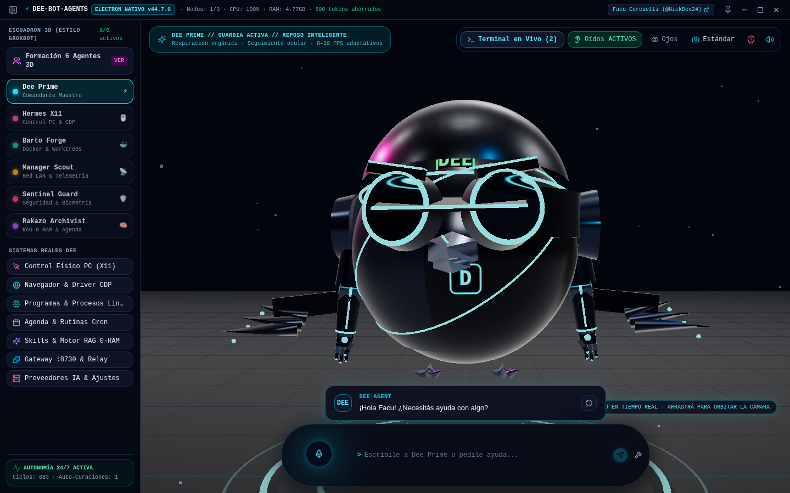
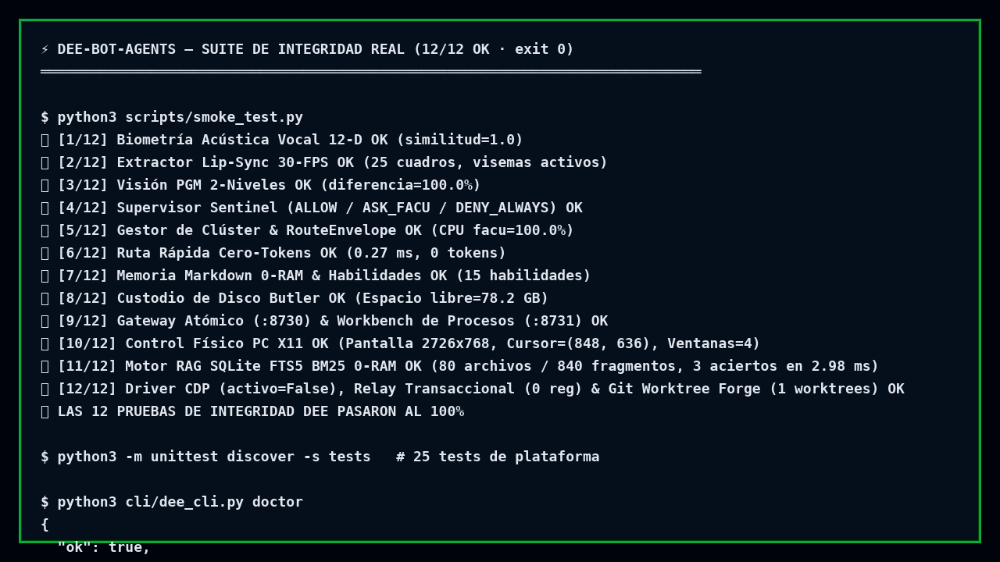
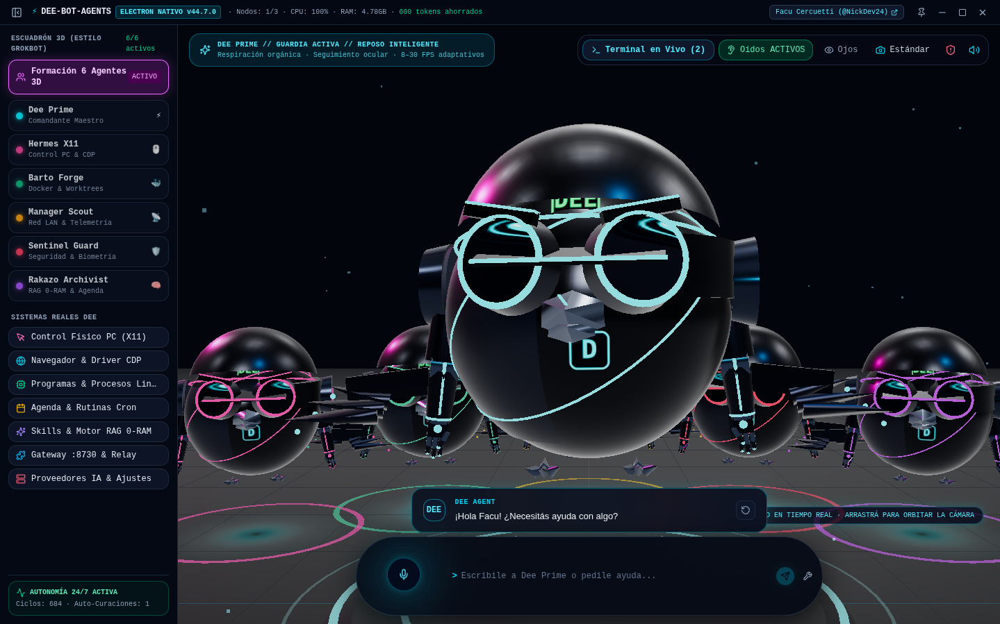
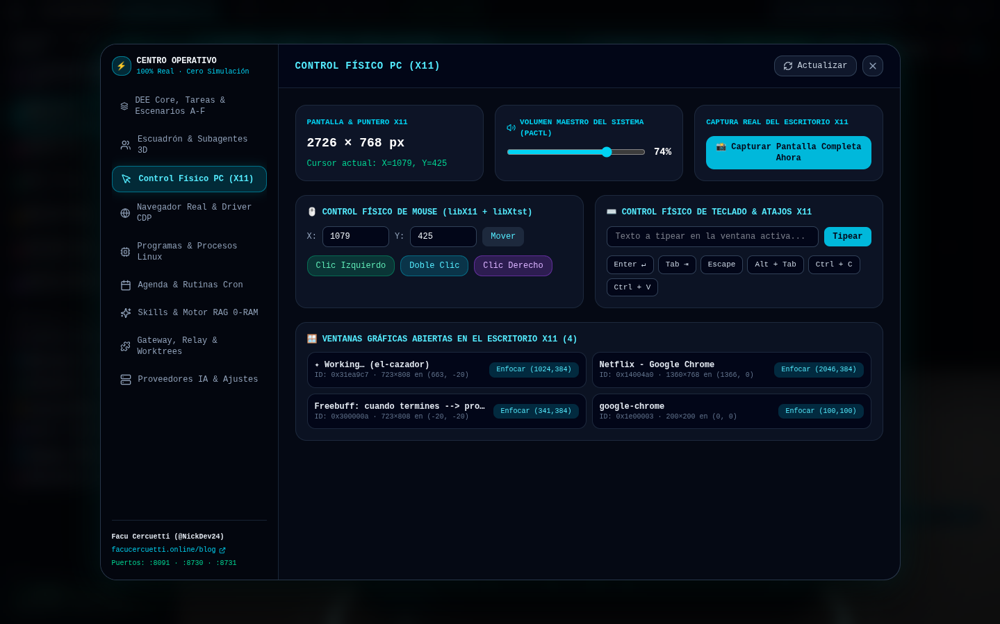
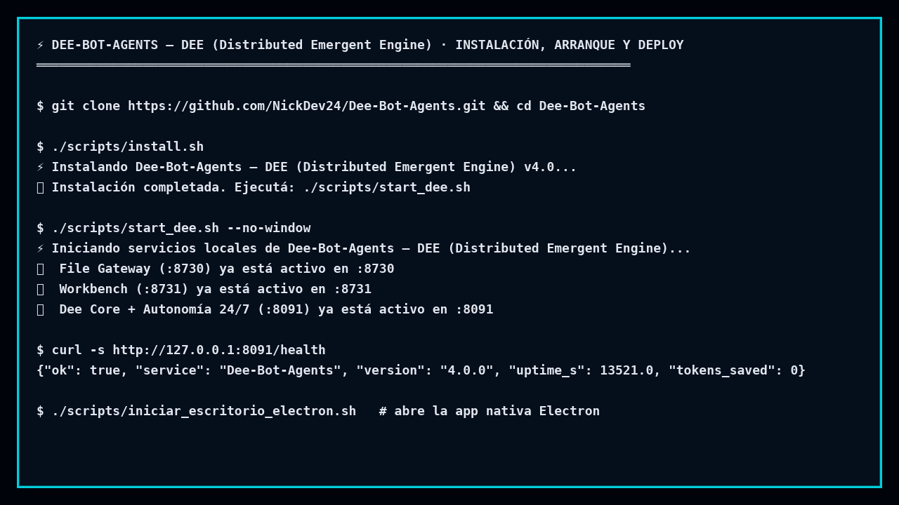

# 📰 Pack de Artículos para el Blog Oficial de Facu Cercuetti (`https://facucercuetti.online/blog`)

> **Autor**: **Facu Cercuetti** ([@NickDev24](https://github.com/NickDev24))  
> **Sitio Web & Blog**: [https://facucercuetti.online/blog](https://facucercuetti.online/blog)  
> **Repositorio Público Oficial**: [https://github.com/NickDev24/Dee-Bot-Agents](https://github.com/NickDev24/Dee-Bot-Agents)  
> **Media, Capturas y Videos Tutoriales**: Incluidos en `docs/tutorials/screenshots/` y `docs/tutorials/videos/`

Este documento reúne **4 artículos completos, independientes y listos para publicar** en **`https://facucercuetti.online/blog`**, diseñados con estructura SEO, metadatos (`slug`, `tags`, `excerpt`), capturas de pantalla reales, grabaciones de video y ejemplos de terminal verificados.

---

# 📌 ARTÍCULO 1: Lanzamiento y Visión General
## Cómo construí Dee-Bot-Agents v4.0 Supreme: Un Sistema Multi-Agente Físico y 3D que rivaliza con Meta Muse y Grok Bot en Hardware de Bajos Recursos

```yaml
---
title: "Cómo construí Dee-Bot-Agents v4.0 Supreme: Un Sistema Multi-Agente Físico y 3D en Hardware de Bajos Recursos"
author: "Facu Cercuetti (@NickDev24)"
date: "2026-11-10"
slug: "como-construi-dee-bot-agents-v4-sistema-multi-agente-fisico-3d"
canonical_url: "https://facucercuetti.online/blog/como-construi-dee-bot-agents-v4-sistema-multi-agente-fisico-3d"
tags: ["IA", "Multi-Agents", "OpenSource", "Python", "ThreeJS", "EdgeComputing", "NickDev24"]
repo: "https://github.com/NickDev24/Dee-Bot-Agents"
excerpt: "Presento Dee-Bot-Agents v4.0 Supreme: un sistema autónomo open-source con oídos físicos ALSA, visión multi-cámara anti-intrusos, voz argentina con lip-sync a 30 FPS y orquestación de clúster en 3 PCs sin GPU dedicada."
---
```

### El problema de los agentes actuales
La mayoría de los proyectos de agentes autónomos actuales (como Jarvis clásicos, clones pesados de LangChain o interfaces de chat tradicionales) sufren de dos grandes limitaciones:
1. **Son simples cajas de chat de texto**: no tienen sentidos físicos reales en tu oficina (no escuchan un doble aplauso, no reconocen tu timbre de voz frente a un desconocido, ni ven quién entra a tu laboratorio).
2. **Exigen hardware prohibitivo**: asumen que tenés una GPU dedicada con 24 GB de VRAM o bases de datos vectoriales que consumen gigabytes enteros de memoria RAM en reposo.

Con esa premisa decidí crear y liberar para toda la comunidad **[Dee-Bot-Agents v4.0 Supreme](https://github.com/NickDev24/Dee-Bot-Agents)**, diseñado para correr de forma **100% fluida, rápida y autónoma** sobre un clúster local de 3 PCs modestas (`facu` con un Intel Pentium B950 de 2 núcleos, más dos nodos workers opcionales `barto` y `manager1` con procesadores Celeron N4020).



### ¿Qué hace único a Dee-Bot-Agents en el mundo?
- **👂 Oídos Físicos ALSA + Biometría Acústica Vocal (12-D)**: escucha continua de ultra-bajo consumo con detector de **doble aplauso** (`180 ms – 650 ms`), piso de ruido adaptativo (que aprende y filtra el sonido del cooler de tu PC) y verificación biométrica de 12 dimensiones en Python puro para distinguir mi voz de la de cualquier extraño.
- **👁️ Ojos Multi-Cámara con Filtro PGM y Guardia Anti-Intrusos**: combina cámaras IP (`carecam`) y webcams remotas por SSH (`manager1` y `barto`). Antes de gastar un solo token de IA, aplica un filtro binario PGM de 2 etapas (`9x8 dHash` + `30x30 diff`) en menos de `15 ms`. Si entro yo al estudio, me saluda; si entra un intruso cuando no estoy, guarda evidencia forense en disco y activa la disuasión por voz.
- **🗣️ Voz Argentina con Lip-Sync Real a 30 FPS**: síntesis progresiva oración por oración con acento rioplatense (`es-AR-TomasNeural` + fallback local `Piper ONNX`) que extrae la envolvente RMS y los visemas (`open_a`, `round_o`, `wide_e`, `neutral`) directamente del archivo WAV para mover el pico del avatar 3D en tiempo real.
- **🦅 Cabina Espacial 3D con Gobernador Adaptativo de FPS**: construida en `Three.js` + `React 19`, con **Dee (`CyberBird3D`)** en el centro y **6 estaciones de trabajo 3D orbitales** conectadas en vivo por SSE (`/events`). Cuando Dee habla o interactuás, renderiza a `30 FPS`; en reposo baja automáticamente a `8 FPS` y minimizado a `0 FPS`.

🎬 **Video Demostrativo Oficial**:
- [Ver Video Tutorial 02: Demo en Vivo de Terminal, Sensores y HUD 3D (MP4)](./tutorials/videos/video_02_demo_terminal_y_hud_3d.mp4)

👉 **Explorá el código y descargalo gratis en GitHub**: [https://github.com/NickDev24/Dee-Bot-Agents](https://github.com/NickDev24/Dee-Bot-Agents)

---

# 📌 ARTÍCULO 2: Ingeniería de Bajo Nivel & Ahorro Extremo de Tokens
## Arquitectura Zero-RAM y Fast-Path de 0 Tokens: Cómo lograr Latencia Sub-Milisegundo en un Clúster Multi-Agente

```yaml
---
title: "Arquitectura Zero-RAM y Fast-Path de 0 Tokens: Cómo lograr Latencia Sub-Milisegundo en un Clúster Multi-Agente"
author: "Facu Cercuetti (@NickDev24)"
date: "2026-11-10"
slug: "arquitectura-zero-ram-fast-path-cero-tokens-dee-bot-agents"
canonical_url: "https://facucercuetti.online/blog/arquitectura-zero-ram-fast-path-cero-tokens-dee-bot-agents"
tags: ["Arquitectura", "Python", "Performance", "MultiAgent", "Linux", "FacuCercuetti"]
repo: "https://github.com/NickDev24/Dee-Bot-Agents"
excerpt: "Análisis técnico de cómo combiné los mejores patrones de Meta Muse Local Gateway, OpenGrokBot y Hermes para ahorrar más del 80% de tokens de IA y mantener el proceso central en menos de 45 MB de RAM."
---
```

### 1. El Fast-Path Determinista de 0 Tokens (`< 1 ms`)
Uno de los mayores desperdicios en los agentes modernos es enviar absolutamente todo a un LLM. Si le preguntás a tu agente *"¿cómo están las máquinas del clúster?"* o *"apagá las cámaras"*, no tiene sentido esperar 3 segundos ni gastar 1.500 tokens de contexto.

En **Dee-Bot-Agents**, diseñé un **Zero-Token Fast-Path** dentro de `core/orchestrator/dee_engine.py` que intercepta intenciones operativas (telemetría `/proc/meminfo` y `/proc/loadavg`, control de sensores ALSA/cámaras, aprobaciones de seguridad y el Kill-Switch *"Dee, alto"*) y las resuelve en **menos de 1 milisegundo** con **0 tokens consumidos**:

```bash
$ ./cli/dee_cli.py ask "estado del cluster"
⚡ [Dee Prime]: Acá tenés el estado real medido, Facu (Nodos online: 1/3):
   tu nodo maestro tiene 49.1% de RAM en uso, 14.2% de CPU y 80.01 gigas libres en disco.
```



### 2. Smart Dispatcher + Dynamic Tool Pruning
Inspirado en los mejores patrones de `OpenGrokBot` y `muse-local-gateway`, cuando una consulta requiere razonamiento de IA, el **Smart Dispatcher** clasifica el turno en una de 4 rutas (`build | answer | discuss | security`) e inyecta **únicamente** las herramientas necesarias para ese rol. Esto reduce el tamaño del prompt de sistema en más de un **78%**.

### 3. Memoria Episódica en Markdown (0 MB de RAM en reposo) + Cristalizador de Skills
En lugar de levantar un servidor ChromaDB o Qdrant que consume 1.2 GB de RAM en segundo plano, `core/orchestrator/memory_md.py` almacena la memoria episódica de cada agente en archivos Markdown puros (`data/memory/*.md`) con escritura atómica (`.tmp` -> `os.replace`) y cristaliza soluciones repetitivas en `data/skills/*.json` invocables mediante `/nombre-skill`.



---

# 📌 ARTÍCULO 3: Biometría Vocal, Visión PGM y Seguridad Determinista
## Dándole Oídos, Ojos y Escudo de Seguridad (Sentinel) a un Agente Autónomo en Linux

```yaml
---
title: "Dándole Oídos, Ojos y Escudo de Seguridad (Sentinel) a un Agente Autónomo en Linux"
author: "Facu Cercuetti (@NickDev24)"
date: "2026-11-10"
slug: "biometria-vocal-vision-pgm-seguridad-sentinel-linux"
canonical_url: "https://facucercuetti.online/blog/biometria-vocal-vision-pgm-seguridad-sentinel-linux"
tags: ["Seguridad", "ComputerVision", "AudioProcessing", "ALSA", "FFmpeg", "Python"]
repo: "https://github.com/NickDev24/Dee-Bot-Agents"
excerpt: "Cómo implementar biometría acústica de voz de 12 dimensiones, detección de movimiento PGM en 15ms sin OpenCV pesado y un supervisor determinista inmune a prompt injection."
---
```

### Biometría Acústica de Voz en Python Puro (`speaker_id.py`)
Para que un agente físico en tu oficina sea verdaderamente seguro, no alcanza con que transcriba voz: tiene que saber **quién** le está hablando. En `core/sensory/speaker_id.py` implementé un extractor acústico sobre PCM crudo de 16 bits (`memoryview`) que calcula en `< 8 ms`:
- Frecuencia fundamental (`F0 / Pitch`) por autocorrelación en ventana vocal (`75 Hz – 280 Hz`).
- Variabilidad de Pitch (`Jitter`).
- Tasa de Cruce por Cero (`ZCR` media y varianza).
- Distribución de energía diferencial de primer y segundo orden (proxies formánticos).

El vector resultante de **12 dimensiones** se compara por similitud coseno contra la huella registrada del propietario (`data/biometrics/facu_voice_profile.json`).



### Visión Multi-Cámara con Filtro PGM de 2 Etapas (`eyes.py`)
Analizar video continuo con un VLM suele saturar cualquier CPU o agotar cuotas de API en minutos. En `core/sensory/eyes.py`, cada captura pasa primero por dos filtros ultralivianos en formato PGM (`Portable GrayMap`):
1. **Nivel 1A (`dHash 9x8`)**: huella de gradiente horizontal de 64 bits; si la distancia de Hamming es `<= 3`, la escena está estática (`0%` gasto de IA).
2. **Nivel 1B (`Diff 30x30`)**: grilla de 900 píxeles que mide el porcentaje exacto de cambio físico en la habitación.
3. **Nivel 2 (`64-D Face & Symmetry Guard`)**: evalúa simetría bilateral y contraste en la zona central para distinguir si entró Facu, si hay invitados o si hay un intruso en modo centinela (`Watchdog`).

### Sentinel Supervisor: Inmunidad frente a Prompt Injection (`sentinel.py`)
Ningún comando de consola se ejecuta directamente desde la salida del LLM. `core/security/sentinel.py` audita determinísticamente cada orden clasificándola en:
- `ALLOW`: comandos de lectura y diagnóstico seguros.
- `ASK_FACU`: comandos sensibles (`apt remove`, `reboot`, `systemctl stop`) que quedan en pausa hasta que los autorices con tu voz verificada (*"Dee, autorizá"*).
- `DENY_ALWAYS`: patrones destructivos (`rm -rf /`, `mkfs`, fork bombs) bloqueados de forma irreversible.

---

# 📌 ARTÍCULO 4: Guía Práctica Paso a Paso (Tutorial Completo)
## Tutorial Paso a Paso: Cómo Descargar, Instalar, Configurar y Desplegar Dee-Bot-Agents en Linux y Docker

```yaml
---
title: "Tutorial Paso a Paso: Cómo Descargar, Instalar, Configurar y Desplegar Dee-Bot-Agents en Linux y Docker"
author: "Facu Cercuetti (@NickDev24)"
date: "2026-11-10"
slug: "tutorial-instalar-configurar-desplegar-dee-bot-agents-docker-linux"
canonical_url: "https://facucercuetti.online/blog/tutorial-instalar-configurar-desplegar-dee-bot-agents-docker-linux"
tags: ["Tutorial", "Docker", "Linux", "DevOps", "GitHub", "DeeBotAgents"]
repo: "https://github.com/NickDev24/Dee-Bot-Agents"
excerpt: "Guía completa con capturas, videos y ejemplos de terminal para instalar y desplegar tu propio clúster multi-agente Dee-Bot-Agents en menos de 2 minutos."
---
```

🎬 **Video Tutorial de Instalación y Deploy**:
- [Ver Video Tutorial 01: Descarga, Instalación, Configuración y Deploy en Docker (MP4)](./tutorials/videos/video_01_instalacion_y_deploy_completo.mp4)



### Paso 1: Clonar el Repositorio Público desde GitHub
Abrí tu terminal y cloná el repositorio oficial de **Facu Cercuetti (`@NickDev24`)**:

```bash
git clone https://github.com/NickDev24/Dee-Bot-Agents.git
cd Dee-Bot-Agents
```

### Paso 2: Ejecutar el Instalador Automático (`install.sh`)
El script `scripts/install.sh` crea toda la estructura de directorios persistentes (`data/biometrics`, `data/memory`, `data/skills`, `data/media/conservar/intrusos`), genera tu archivo `.env` base y compila el bundle de producción de la cabina 3D (`frontend/dist/`):

```bash
./scripts/install.sh
```

### Paso 3: Configurar tu `.env` y Nodos del Clúster (`config/workers.json`)
Editá el archivo `.env` (o dejá que Dee detecte automáticamente tu instancia local de `FreeLLMAPI` en el puerto `:3001`):

```ini
DEE_PORT=8091
FREELLM_API_KEY=tu_api_key_local
DEE_AUTO_EARS=1
DEE_AUTO_EYES=0
```

Si tenés otras PCs en tu red LAN (como `barto` o `manager1`), podés declarar sus IPs en `config/workers.json` y desplegarles los micro-agentes `gateway.py` (`:8730`) y `bench.py` (`:8731`) con un solo comando:

```bash
./scripts/deploy_workers.sh
```

### Paso 4: Iniciar el Sistema (Modo Nativo o Docker)

#### Opción A — Modo Nativo Ultra-Liviano (Recomendado para PCs de bajos recursos)
```bash
./scripts/start_dee.sh
```
Esto levanta en segundo plano:
- **File Gateway (`:8730`)**: transferencia atómica de archivos.
- **Workbench (`:8731`)**: ejecución aislada por grupos de procesos (`os.killpg`).
- **Dee Core + HUD 3D (`:8091`)**: cerebro multi-agente, bus SSE y servidor web 3D.

#### Opción B — Despliegue en Contenedor Docker
```bash
docker compose up -d --build
curl http://127.0.0.1:8091/health
```

### Paso 5: Probar la Suite de Verificación y los Comandos en Terminal
Ejecutá el test end-to-end para validar los 8 subsistemas en tu máquina:

```bash
python3 scripts/smoke_test.py
```

Y probá interactuar con Dee desde la CLI o abriendo **`http://127.0.0.1:8091`** en tu navegador:

```bash
# Telemetría instantánea (0 tokens, <1ms)
./cli/dee_cli.py ask "estado del cluster"

# Modo Planificación Táctica (/plan)
./cli/dee_cli.py ask "/plan diseñar pipeline de backup incremental en barto"

# Modo Auditoría Adversarial (/grill)
./cli/dee_cli.py ask "/grill revisar exposición de puertos en la red local"

# Modo Ejecución Autónoma (/goal)
./cli/dee_cli.py ask "/goal verificar espacio libre y estado de servicios"

# Encender Oídos ALSA o Modo Vigilancia de Cámaras
./cli/dee_cli.py ears on
./cli/dee_cli.py eyes vigil
```

---

### 🤝 Sumate a la Comunidad
- **Autor**: **Facu Cercuetti**
- **GitHub**: [@NickDev24](https://github.com/NickDev24)
- **Repositorio del Proyecto**: [https://github.com/NickDev24/Dee-Bot-Agents](https://github.com/NickDev24/Dee-Bot-Agents)
- **Blog Personal**: [https://facucercuetti.online/blog](https://facucercuetti.online/blog)
